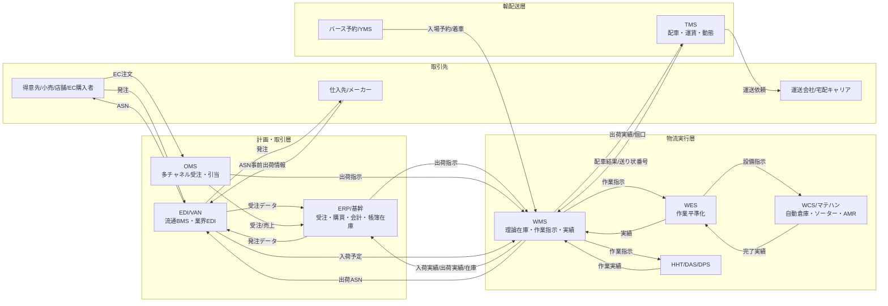
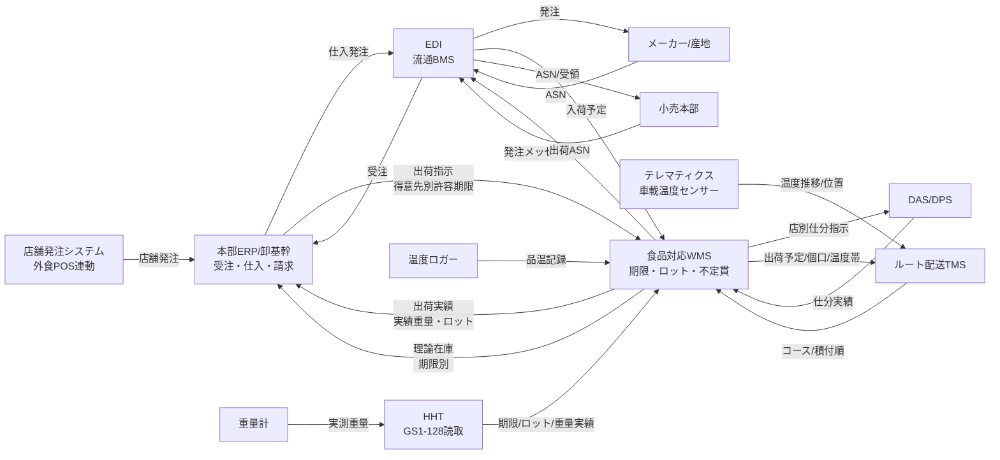
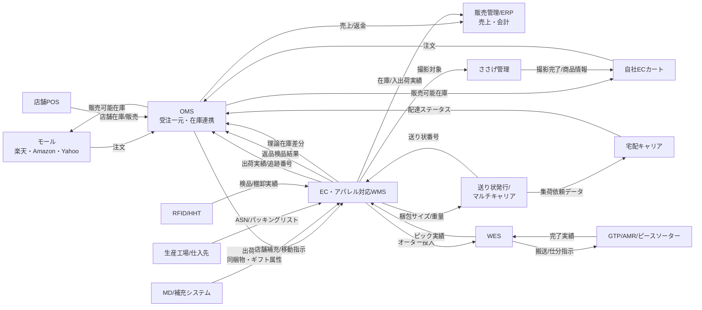
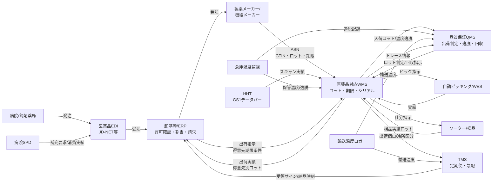
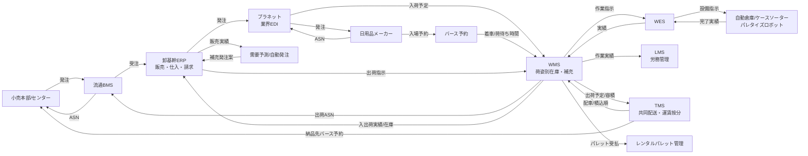
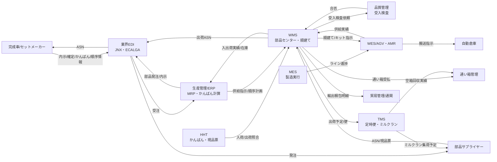
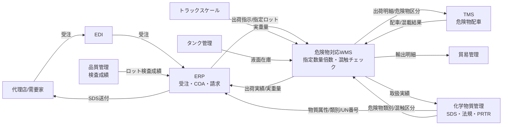

# WMS中心の物流SCMアーキテクチャ・業界別機能マップ（日本市場版）

> 対象読者：荷主企業の物流・情シス部門、3PL事業者のシステム企画担当、SIer／コンサルタント
> 位置づけ：構想策定〜RFP作成時の「業務×機能×システム分担」の共通言語
> 注記：製品名・シェアに関する記述は、公開情報（ベンダー公表の導入実績、矢野経済研究所等の市場調査の公表サマリー、業界紙報道）をもとにした**定性的な位置づけ**です。具体的な数値シェアは調査年度や「導入社数／拠点数／売上」のどれで測るかで順位が変わるため、本書では断定しません。RFP前に最新版の調査レポートとベンダー提示の実績で裏付けを取ってください。

---

## 目次

- [0. 共通編：日本型SCMシステム構成の全体像](#0-共通編日本型scmシステム構成の全体像)
- [1. 飲食・外食・食品卸（デイリー／3温度帯）](#1-飲食外食食品卸デイリー3温度帯)
- [2. EC・通販・アパレル（オムニチャネル／ピースピッキング）](#2-ec通販アパレルオムニチャネルピースピッキング)
- [3. 医薬品・医療機器（GDP対応／ロット・シリアル追跡）](#3-医薬品医療機器gdp対応ロットシリアル追跡)
- [4. 日用品・FMCG・消費財卸（パレット流通／共同配送）](#4-日用品fmcg消費財卸パレット流通共同配送)
- [5. 製造業・自動車・電機部品（かんばん／JIT／アセンブリ）](#5-製造業自動車電機部品かんばんjitアセンブリ)
- [6. 化学・危険物（消防法・毒劇法／ドラム・IBC・不定貫）](#6-化学危険物消防法毒劇法ドラムibc不定貫)
- [7. 業界横断比較サマリー](#7-業界横断比較サマリー)
- [付録. 用語集](#付録-用語集)

---

## 0. 共通編：日本型SCMシステム構成の全体像

### 0-1. なぜ日本では「専業WMS＋周辺システム」のベストオブブリードになるのか

| 要因 | 内容 | システム構成への影響 |
| :--- | :--- | :--- |
| **3PLの介在** | 物流を3PLに委託する荷主が多く、倉庫オペレーションの主体と在庫の所有者が別会社 | 荷主ERPとは別に、3PL側が**マルチ荷主（マルチクライアント）WMS**を保有。荷主ERP内蔵WMSは使えない |
| **納品先ごとの細かい要求** | 小売センター納品ルール（日付逆転禁止、納品期限、カテゴリ納品、指定ラベル） | 出荷先マスタ単位のルールエンジンが必要。ERP標準のWM機能では表現できない |
| **荷姿の多様性** | ピース／ボール（内箱）／ケース／パレット、不定貫、セット品 | 多段階の入数・荷姿換算とロケーション種別を持つWMSが必須 |
| **業界EDIの分断** | 流通BMS、プラネット（日用品）、JD-NET／医薬EDI、JNX（自動車）、ECALGA（電機）等 | EDI変換（VAN／EDIゲートウェイ）を独立レイヤーとして配置 |
| **現場改善文化** | ハンディ画面・帳票・作業順をセンターごとに最適化したい | カスタマイズ性の高い国産WMS、またはノンカスタマイズ前提のクラウドWMSに二極化 |
| **物流2024年問題** | ドライバー時間外労働上限規制（2024年4月〜）、2025年4月施行の改正物流効率化法による荷主の努力義務・特定荷主の計画作成義務 | **TMS・バース予約・荷待ち時間の記録**がWMSの外に独立して急速に普及 |

### 0-2. システムの役割定義（本書での境界線）

| システム | 正式名称 | 本書での責務 | 責務の「外」 |
| :--- | :--- | :--- | :--- |
| **ERP／基幹** | Enterprise Resource Planning | 受注・売上・請求・会計・**帳簿在庫（金額在庫）**・購買 | ロケーション、作業指示 |
| **OMS** | Order Management System | 多チャネル受注の集約、在庫引当（チャネル配分）、出荷指示の振り分け | 倉庫内の物理作業 |
| **WMS** | Warehouse Management System | **ロケーション在庫（理論在庫）**、入荷・保管・ピッキング・出荷の作業指示と実績、ロット／期限管理 | 配車・運行、会計 |
| **WES** | Warehouse Execution System | 複数マテハン・人作業のリアルタイムな作業平準化（ウェーブレス、波動吸収） | 在庫の正（マスタ）は持たない |
| **WCS** | Warehouse Control System | 個々の設備（自動倉庫、ソーター、AGV/AMR）の制御 | 業務ロジック |
| **TMS** | Transportation Management System | 配車計画、運賃計算、運行・動態管理、送り状発行 | 庫内作業 |
| **YMS／バース予約** | Yard Management System | トラック入場予約、荷待ち・荷役時間の計測 | 荷物単位の管理 |
| **EDI** | Electronic Data Interchange | 取引先との受発注・ASN・受領データの標準変換 | 業務判断 |

> **鉄則：在庫の「正」を二重化しない。**
> 金額在庫（帳簿）＝ERP、数量・ロケーション・ロット在庫（理論在庫）＝WMS。両者は日次（または都度）の在庫照合で差異管理する。

### 0-3. 全体アーキテクチャ（業界共通テンプレート）

---

## 1. 飲食・外食・食品卸（デイリー／3温度帯）

### ① 業界の物流特性と固有の商習慣

| 観点 | 内容 |
| :--- | :--- |
| **リードタイム特性** | 店舗発注締め（例：前日10時〜16時）→翌朝〜翌日納品の**1〜2日LT**が標準。デイリー（弁当・惣菜・パン・牛乳）は**当日発注・当日複数便（1日2〜3便）**。外食チェーンは店舗締めが深夜（閉店後）で、早朝納品に間に合わせるため**センター作業時間が4〜6時間しかない** |
| **管理単位と荷姿** | ケース（メーカー出荷単位）／ボール／ピース（バラ）、店舗別**オリコン（折りたたみコンテナ）・番重**、カゴ車（ロールボックスパレット）。精肉・鮮魚・青果は**不定貫（重量で価格が決まる）**、GS1-128の**重量（AI:3102等）・賞味期限（AI:17）・ロット（AI:10）**を読み取る |
| **温度帯** | 常温（ドライ）／定温（15〜18℃：チョコ・米飯）／冷蔵（チルド 0〜10℃）／冷凍（−18℃以下）。センター・トラックとも**区画（室）単位で温度管理** |
| **特有の商慣習** | ・**1/3ルール**（製造日〜賞味期限の1/3以内に小売へ納品。加工食品の一部は**1/2ルールへ緩和**の流れ） ・**日付逆転禁止**（同一納品先に前回納品より古い賞味期限を納品してはならない） ・**鍵預かり夜間・早朝納品**（店舗無人時に預かり鍵で入店し、検品レス納品） ・**センターフィー**（小売の物流センター利用料。卸・メーカーが負担） ・**TC/DC**（通過型／在庫型）センターの併存、カテゴリ納品・通路別仕分け ・**食品表示法・HACCP制度化（2021年6月完全施行）**による温度記録・トレーサビリティ ・**年月表示化**（賞味期限3か月超の商品は「年月」表示へ移行中で、日付管理粒度が混在） |

### ② 【業務 × 機能 × 担当システム】詳細対応マトリクス

| 業務フェーズ | 具体的な業務内容 | 求められる詳細機能（複数列挙） | 主に担当するシステム | なぜそのシステムが担うのか（理由・境界線） |
| :--- | :--- | :--- | :--- | :--- |
| **発注・需要受付** | 店舗・外食チェーンからの日次発注受付、小売本部からの流通BMS発注受信 | ・店舗別／便別**締切時刻制御**（締め後発注は翌便へ自動繰越） ・日替わりメニュー・セットメニューの**所要量展開（レシピBOM）** ・**発注単位丸め**（バラ→ケース換算、最小発注単位チェック） ・欠品時の**代替品推奨・自動差し替え** ・流通BMSメッセージ（発注・出荷・受領・返品）変換 | 店舗発注システム（外食はPOS連動の自動発注）／EDI（流通BMS）／本部基幹ERP | 発注は**取引（価格・与信・契約）**であり、単価・得意先条件を持つERP側の責務。レシピ展開は外食本部の業務ロジックなので店舗発注システム。WMSは「確定した出荷指示」以降のみを受ける |
| **引当・計画** | 在庫引当、仕入発注、センター作業量予測、便割付 | ・**賞味期限別引当**（納品先ごとの許容期限＝1/3・1/2・個別契約を判定して引当） ・**日付逆転チェック**（得意先×商品の前回納品期限との比較） ・TC品の**仕入先別総量発注（店別数量の合算）** ・便／温度帯／コース別の出荷波動計画 | ERP（数量引当・仕入発注）＋ **WMS（ロット・期限引当）** | ERPは「何ケース出せるか」、WMSは「**どのロット・どの期限**を出すか」。期限別の物理在庫はWMSにしかないため、**期限引当はWMSが正**。ERP側で期限まで引き当てると、棚の実態とずれて逆転事故の原因になる |
| **入荷・検品** | メーカー・産地からの入荷、TC品の店別仕分け済み入荷 | ・**ASN照合**（事前出荷情報とSCMラベルの突合、ノー検品化） ・**賞味期限受入基準判定**（残存期間が受入基準＝製造日から1/3以内等を満たすか。満たさなければ受入拒否／要承認） ・**不定貫バーコード（GS1-128 重量AI）読取→重量実績をマスタ・単価に紐付け** ・**品温チェック**（芯温計・温度ロガーの値の記録、逸脱時アラート） ・ロット・産地情報登録（トレーサビリティ） | **食品対応WMS** ＋ HHT（GS1-128対応）＋ 温度ロガー／重量計連動 | 期限・ロット・重量を**ケース単位の実物から取得**する必要があり、現場端末と直結するWMSの責務。重量実績は売上金額に影響するため、WMS→ERPへ**実績重量**を返し請求をERPで確定する |
| **保管・在庫管理** | 温度帯別ロケーション保管、期限管理、棚卸 | ・**温度帯別ロケーション**（常温／定温／冷蔵／冷凍のゾーン制約） ・**FEFO**（First Expired First Out）ロケーション引当 ・**出荷許容期限切れ（販売期限）アラート**、見切り・処分在庫への自動区分変更 ・アレルゲン・ハラール等の**混載禁止属性** ・循環棚卸（日次ゾーン棚卸） | **WMS** | 期限・ロケーション単位の在庫はWMSの専管。ERPは金額在庫のみを保持し、廃棄・評価損はWMSの在庫区分変更実績を受けて計上 |
| **ピッキング・加工** | 温度帯別ピッキング、店別仕分け、デイリー品の総量ピック | ・**3温度帯別バッチピッキング**（冷凍→冷蔵→常温の作業順制御） ・**FEFO＋納品先別逆転防止アラート**（ピック時スキャンで期限を再チェック） ・**総量ピッキング→店舗別オリコン種まき（DAS）** ・精肉・鮮魚の**計量・値付け（パック加工）** | WMS ＋ **DAS（デジタルアソートシステム）**／DPS ＋ WES（大規模センター） | DASは「どの店に何個」を表示器で指示するだけの**実行層**。どのロットを出したかの記録はWMSに戻す必要がある。物量が多い小売専用センターではWESで温度帯・便ごとの波動を平準化 |
| **仕分・出荷検品** | 店別・コース別仕分け、カゴ車積付け、出荷検品 | ・**コース別・納品順（ルート逆順）積付け指示** ・カゴ車・オリコンへの**SCMラベル／店舗ラベル発行** ・**オリコン・番重の回収数管理**（通い容器の貸借） ・出荷ASN（流通BMS出荷メッセージ）生成 | WMS ＋ ソーター（大規模TC）＋ EDI | 積付け順は配送ルートに依存するため、TMSのコース情報をWMSが受けて作業指示化。ASNは出荷実績（実際に積んだロット・数量）が起点なのでWMSが生成 |
| **配送・運行管理** | ルート配送、店舗納品、温度記録 | ・**温度帯混載2室／3室トラックの配車計算**（室容量・温度帯制約） ・**店舗納品時間枠（深夜・早朝）指定**と時間指定違反の予測 ・**鍵預かり納品の実績登録**（納品写真・時刻・鍵返却） ・**庫内温度推移のエビデンス保持**（HACCP・クレーム対応） ・オリコン回収実績 | **食品ルート配送向けTMS**（自動配車クラウド）＋ テレマティクス／デジタコ（温度センサー連動）＋ 動態管理 | 配車は車両・ドライバー・時間枠の最適化問題で、WMSの在庫ロジックとは独立。温度記録は車両側センサーが一次情報のため、テレマティクス→TMSで保持し、必要時にWMSの出荷実績と出荷番号で紐付け |

### ③ データ連携アーキテクチャ図

### ④ 日本市場における主要システム製品・シェア動向・選定基準

**主要パッケージ製品名とベンダー**

| 区分 | 製品（ベンダー） | 得意領域・強み |
| :--- | :--- | :--- |
| WMS | **ci.Himalayas**（シーネット） | 国内導入実績が非常に多い汎用WMSの代表格。食品卸・小売センター・3PLでの実績が厚く、賞味期限・ロット管理、HHT連携が標準。クラウド版も展開 |
| WMS | **SLIMS**（セイノー情報サービス） | 3PL・食品・医薬などの大規模センター向け。多温度帯、マルチ荷主、多言語・海外拠点対応 |
| WMS | **ONEsLOGI/WMS**（ロジスティードソリューションズ） | 大手3PL（旧日立物流）の現場ノウハウを反映。大規模・多拠点、食品・医薬の厳格なロット管理 |
| WMS（グローバル） | SAP EWM、Manhattan Active WM、Blue Yonder WMS | 大手食品メーカーの自社DC、グローバル統一案件。ERP（S/4HANA）と一体で選ばれる |
| TMS・配車 | LYNA 自動配車クラウド（ライナロジクス）、Loogia（オプティマインド）、MOVO（Hacobu：動態管理・バース予約） | ルート配送の自動配車、時間枠制約、動態・荷待ち可視化 |
| マテハン | DAS／DPS（アイオイ・システム等）、ソーター・自動倉庫（ダイフク、村田機械、トーヨーカネツ、オカムラ等） | 店別仕分け、冷凍自動倉庫 |

**システム選定の決定要因（Key Buying Factor）**

1. **賞味期限逆転防止・許容期限引当が標準機能か**（得意先×商品単位の前回納品期限保持、1/3・1/2・個別契約の切替）
2. **不定貫（GS1-128重量AI）とケース・ボール・バラの多段換算に対応しているか**、実績重量をERPの請求に返せるか
3. **多温度帯センター・3PLでの稼働実績**（特に短時間作業・夜間ピーク処理での性能実績）

**よくあるアンチパターン・失敗例**

- **ERP標準の在庫管理で期限を「ロット」としてだけ管理** → 得意先別の許容期限・逆転チェックができず、Excelで期限表を作って人手で確認。繁忙期に逆転納品が発生し、小売からペナルティ・取引停止リスク。
- **自社開発WMSで不定貫を「平均重量×ケース数」で処理** → 請求金額と実重量がずれ、月末に手修正。後から重量実測を入れようとするとマスタ構造ごと作り直しになる。
- **TMSを入れずにWMSのコースマスタで配車を固定** → 2024年問題で便を統合・再編したくてもコース変更のたびにWMSマスタ改修が必要になり、配送改革が止まる。

---

## 2. EC・通販・アパレル（オムニチャネル／ピースピッキング）

### ① 業界の物流特性と固有の商習慣

| 観点 | 内容 |
| :--- | :--- |
| **リードタイム特性** | **当日出荷（例：14〜15時締め当日出荷）**、翌日配送が競争条件。モール（楽天市場・Amazon・Yahoo!ショッピング）の出荷期限・配送品質指標を守らないとランキング・バッジに影響。セール・新作発売・福袋で**平常時の5〜10倍の波動** |
| **管理単位と荷姿** | **ピース（1点）単位**が基本。アパレルは**SKU＝品番×カラー×サイズ**で品目数が爆発（数万〜数十万SKU）。出荷はポリ袋・段ボール・ネコポス／ゆうパケット等の**メール便サイズ**。店舗向けは店別ケース |
| **特有の商慣習** | ・**ささげ業務**（撮影・採寸・原稿作成）が入荷直後に発生し、販売開始のボトルネック ・**流通加工**（検針、値札・下げ札付け、たたみ直し、ギフトラッピング、同梱チラシ、ノベルティ） ・**返品・交換**が多い（アパレルEC返品率は高く、試着返品・サイズ交換）。B品判定・再商品化 ・**消化仕入・委託**（百貨店・ファッションビル）と**店舗間移動**、**EC在庫と店舗在庫の共有（オムニチャネル、BOPIS／店舗受取）** ・**RFIDタグ**の普及（アパレルSPAで入出荷・棚卸の一括読取） ・**後払い・代引き・定期購入（サブスク）**、同梱制御（同一顧客の複数注文の同梱） |

### ② 【業務 × 機能 × 担当システム】詳細対応マトリクス

| 業務フェーズ | 具体的な業務内容 | 求められる詳細機能（複数列挙） | 主に担当するシステム | なぜそのシステムが担うのか（理由・境界線） |
| :--- | :--- | :--- | :--- | :--- |
| **発注・需要受付** | 自社EC・各モールの注文取込、店舗補充発注、卸先（百貨店・セレクトショップ）受注 | ・**複数モール注文の一元取込**とステータス同期 ・与信・**不正注文検知**、後払い審査結果連携 ・**同梱判定**（同一住所・同一顧客の注文マージ） ・予約販売・定期購入の出荷日管理 ・ギフト・のし・配送日時指定の属性保持 | **OMS（受注一元管理）**／ECカート（Shopify、futureshop、ecbeing等）／卸向けは販売管理ERP | 注文はチャネルごとにAPI・ステータスが異なり、変化が速い。顧客・決済・キャンセル処理は「取引」なのでOMSが責務。WMSに持たせるとモール仕様変更のたびに倉庫システム改修が発生する |
| **引当・計画** | チャネル別在庫配分、倉庫・店舗の出荷元決定、補充計画 | ・**在庫連携（チャネルごとの販売可能在庫の配信、安全在庫・在庫按分）** ・**出荷拠点の自動決定（倉庫／店舗出荷／BOPIS）** ・**ウェーブ／バッチ作成**（締め時刻・配送キャリア・サイズ別） ・店舗補充・**店舗間移動（在庫消化）**計画 | **OMS（販売可能在庫・拠点決定）**＋ **WMS（物理引当・ウェーブ作成）**／MD・補充システム | 「どの拠点から出すか」は全社在庫を見るOMSの責務、「どの棚から出すか」はWMSの責務。販売可能在庫の正をOMSに置き、WMSの理論在庫を**差分で高頻度同期**するのが定石（売り越し防止） |
| **入荷・検品** | 工場・海外生産拠点からの入荷、店舗返品入荷、EC返品 | ・**ASN（パッキングリスト）照合**、カートン単位一括入荷 ・**RFID一括読取検品**（ケースを開けずに点数照合） ・**ささげ用サンプル引抜き**と撮影キュー連携 ・**返品理由・B品判定・再商品化（再たたみ・再タグ）**、返金トリガー連携 ・JANなし商品への**自社バーコード（SKUラベル）発行・貼付** | **WMS** ＋ HHT／RFIDリーダー ＋ **ささげ管理システム**（またはWMSのささげモジュール） | 現物単位の検品・ラベル貼付はWMSの責務。返品の「返金」はOMSの責務なので、WMSは**返品検品結果（良品／B品）**だけをOMSへ返す境界にする |
| **保管・在庫管理** | 固定／フリーロケーション、ハンガー保管、棚卸 | ・**フリーロケーション＋ABC分析による定期ロケーション再配置** ・**ハンガー（吊り）／平置き／棚の荷姿別ロケーション** ・SKU（品番×色×サイズ）マトリクスでの在庫照会 ・**RFID棚卸**、循環棚卸 ・セット品・アソート品の構成在庫管理 | **WMS** ＋ RFID | SKU数が多く入れ替えが激しいため、ロケーション最適化はWMSの中核機能。マトリクス照会はアパレル特化WMSの差別化要素 |
| **ピッキング・加工** | ピースピッキング、トータルピッキング＋仕分け、流通加工 | ・**シングル／トータル（摘み取り→種まき）切替**、**カートピッキング（マルチオーダー同時ピック）** ・**GTP（Goods to Person：AutoStore、AMR棚搬送）**連携 ・**流通加工指示**（検針、値札・タグ付け、たたみ、ギフト包装、同梱物の顧客別指示） ・**波動時のウェーブレス・リアルタイム投入** | WMS ＋ **WES** ＋ マテハン（AutoStore、Geek+、GreyOrange等のGTP／AMR、ピースソーター） | ロボット・人を混在させた作業平準化はWMSのバッチ処理では追従できないためWESを挟む。同梱物・ギフトは注文属性（OMS由来）なので、WMSの作業指示に**注文属性を引き継ぐ**設計が必須 |
| **仕分・出荷検品** | 注文単位仕分け、梱包、送り状発行 | ・**ピースソーター／ポケットソーター／DASによる注文単位仕分け** ・**梱包サイズ自動判定（3辺計測・最適箱提案）** ・**送り状・納品書の自動発行（キャリアAPI）**、ネコポス等の厚さ判定 ・**誤出荷防止の1点ずつスキャン検品**、重量検品 ・出荷完了→**追跡番号のOMS／モールへの返却** | WMS ＋ ピース・ポケットソーター ＋ 自動梱包機 ＋ **送り状API**（ヤマトB2クラウド、佐川e飛伝、日本郵便ゆうプリR等） | 送り状はキャリア仕様に依存し頻繁に変わるため、WMSから**送り状発行API（またはTMS／送り状発行システム）**へ分離。追跡番号は顧客通知（OMSの責務）に必要なので、WMS→OMSへ返す |
| **配送・運行管理** | 宅配キャリア選定、店舗配送、置き配・受取場所 | ・**キャリア自動振分け**（サイズ・地域・運賃・リードタイム） ・**配送日時指定・置き配・コンビニ／ロッカー受取** ・**運賃計算と請求照合** ・店舗向けは**ルート配送・館内納品（ビル納品代行）** ・不在・配達完了ステータスの取得 | **送り状発行システム／TMS（キャリア振分け）**＋ キャリアAPI ＋ OMS（顧客通知） | ラストワンマイルはキャリアに委託するため、自社の責務は「振分け・運賃・追跡情報の取得」。配車計算型TMSより**マルチキャリア出荷システム**が中心になる |

### ③ データ連携アーキテクチャ図

### ④ 日本市場における主要システム製品・シェア動向・選定基準

**主要パッケージ製品名とベンダー**

| 区分 | 製品（ベンダー） | 得意領域・強み |
| :--- | :--- | :--- |
| クラウドWMS | **ロジザードZERO**（ロジザード） | EC・アパレル・小売のクラウドWMSの代表格。カート・OMS・送り状システムとの標準連携が豊富で、短期導入・3PL利用も多い |
| クラウドWMS | **クラウドトーマス**（関通） | EC物流代行の現場から生まれたクラウドWMS。EC中小〜中堅、物流代行事業者 |
| OMS＋WMS | **LOGILESS**（ロジレス） | OMSとWMSを一体化し、受注〜出荷の自動化に強い。D2Cブランド向け |
| OMS | ネクストエンジン（Hamee）、CROSS MALL（アイル）、TEMPOSTAR 等 | 多モール受注一元管理・在庫連携 |
| WMS（大規模） | ci.Himalayas（シーネット）、SAP EWM、Manhattan Active WM | 大手アパレルSPA・総合通販の大規模自動化センター |
| マテハン | AutoStore、Geek+、GreyOrange、Rapyuta Robotics、ピース・ポケットソーター（ダイフク、トーヨーカネツ、オークラ輸送機等） | GTP・ピース仕分けによる省人化 |

**シェア動向**：EC事業者・EC物流代行の拡大により、**月額課金のクラウドWMSが新規導入の主流**。一方で年商数百億円級のSPA・総合通販は、マテハン自動化と一体で大規模WMS／WESを採用する二極化が進んでいる。

**システム選定の決定要因（Key Buying Factor）**

1. **カート・モール・OMS・送り状システムとの標準API連携数**（連携開発なしで立ち上がるか）
2. **波動対応力**（セール時のウェーブレス投入、マテハン／WES連携、クラウドの性能上限）
3. **アパレル固有機能**（SKUマトリクス、ささげ・流通加工指示、返品再商品化、RFID）

**よくあるアンチパターン・失敗例**

- **ECカートの在庫を「正」にしてWMSと日次バッチ連携** → セール中に売り越し・キャンセル多発。在庫の正をOMSに寄せ、WMSとは差分高頻度連携にすべきだった。
- **ERP（販売管理）の出荷機能でEC出荷を回す** → ピース単位・同梱・ギフト・送り状を扱えず、Excelと手書きで補完。人手で波動を吸収できず出荷遅延。
- **自社開発WMSでマテハンを直接制御** → AMR・ソーター追加のたびに改修が必要になり、自動化投資が遅れる。WESで制御層を分離すべきだった。

---

## 3. 医薬品・医療機器（GDP対応／ロット・シリアル追跡）

### ① 業界の物流特性と固有の商習慣

| 観点 | 内容 |
| :--- | :--- |
| **リードタイム特性** | 医薬品卸から病院・調剤薬局へは**1日複数回（午前・午後）の多頻度小口配送**、急配（緊急配送）は数時間以内。医療機器は手術日程に合わせた**手術日前日・当日のセット納品**。メーカー→卸は在庫補充型で数日LT |
| **管理単位と荷姿** | **調剤包装単位（PTPシート・アンプル等）／販売包装単位（箱）／元梱包装単位（ケース）**。医療機器は**単品（シリアル）・手術セット（キット）・貸出器械**。冷所品（2〜8℃）、凍結品、生物由来製品、**麻薬・向精神薬・毒薬・劇薬**の区分管理 |
| **特有の商慣習** | ・**GDPガイドライン**（医薬品の適正流通基準。2018年12月に厚労省から発出）：温度管理・バリデーション・逸脱管理・偽造品防止 ・**GS1バーコード表示**（医療用医薬品・医療機器。変動情報＝**有効期限（AI:17）・ロット（AI:10）・シリアル（AI:21）**、GTIN（AI:01））。改正薬機法により2022年12月から表示が義務化 ・**有効期限・ロット・製造番号の完全トレース**（回収時に「どの医療機関に何ロット出したか」を即時特定） ・**麻薬は施錠された麻薬金庫保管・帳簿記録**、毒薬・劇薬は区分保管 ・**医療機器の預託在庫（消化払い）・貸出（ローナー）**、病院院内物流の**SPD** ・**返品受入時の品質確認**（温度履歴が不明な返品は再販不可） |

### ② 【業務 × 機能 × 担当システム】詳細対応マトリクス

| 業務フェーズ | 具体的な業務内容 | 求められる詳細機能（複数列挙） | 主に担当するシステム | なぜそのシステムが担うのか（理由・境界線） |
| :--- | :--- | :--- | :--- | :--- |
| **発注・需要受付** | 病院・薬局からの発注（EDI・オンライン発注・MS（営業担当）経由）、手術予定に基づく機器手配 | ・**医薬品業界EDI（JD-NET等）・オンライン発注受信** ・**販売先の許可・資格確認**（薬局開設許可、麻薬施用者免許、向精神薬取扱） ・**急配フラグ・定期便の振分け** ・医療機器：**手術予定（術式）→セット構成展開** ・限定出荷・出荷調整品の**割当（配分）制御** | **卸基幹ERP（販売管理）**／医療機器はSPD・手術器械管理システム／EDI | 販売先の許可確認・割当は法規と取引条件に関わるため基幹側の責務。出荷調整品の配分（供給不足時）も得意先重要度を持つ基幹で判断する |
| **引当・計画** | ロット・有効期限引当、冷所品・特殊品の便計画 | ・**FEFO引当**と**得意先別の有効期限下限（例：残存6か月以上）** ・**同一ロット揃え**（病院からのロット統一要望） ・**回収対象ロット・品質保留ロットの引当除外** ・冷所品の**保冷BOX・蓄冷剤の所要計算** | **WMS（ロット・期限・ステータス引当）**＋ ERP（数量） | 品質保留・回収ロットのステータスは物理在庫単位で管理する必要があり、WMSが正。QA（品質保証）部門の出荷可否判定をWMSのロットステータスに反映する |
| **入荷・検品** | メーカーからの入荷、返品入荷 | ・**GS1-128／GS1データバー読取によるGTIN・ロット・有効期限・シリアル自動取得** ・**ASN照合と数量・ロット差異チェック** ・**冷所品の到着時温度確認、輸送中温度データ（ロガー）の取込・逸脱判定** ・**入荷品の品質判定待ち（検疫在庫）ステータス** ・**返品の温度履歴・外観確認→再販可否判定** | **医薬品対応WMS** ＋ HHT（GS1データバー対応）＋ 温度ロガー | GDP上、ロット・期限・温度の記録は**現物単位で残す必要**があり、作業と同時に記録できるWMSが担う。入力の手書き・後付けは監査で指摘対象になる |
| **保管・在庫管理** | 温度区分保管、特殊医薬品保管、棚卸 | ・**温度区分ロケーション**（室温1〜30℃／冷所2〜8℃／凍結）と**倉庫内温度マッピング・常時モニタリング** ・**麻薬・向精神薬・毒薬の区分ロケーションとアクセス制限**、麻薬帳簿 ・**ロットステータス管理**（合格／保留／回収／不良） ・**有効期限切迫アラート**と返品・廃棄処理 ・**監査証跡（誰がいつ何を変更したか）**、電子記録の改ざん防止 | **WMS** ＋ 温度監視システム（BMS／環境モニタリング） | 温度監視は設備側の常時監視であり、WMSとは別システムで保持し、逸脱時にWMSのロケーション・ロットへ影響範囲を紐付ける。監査証跡はGDP・CSV（コンピュータ化システムバリデーション）の観点でWMS側に必須 |
| **ピッキング・加工** | 多品種小ロットピッキング、セット組み | ・**バラ（調剤包装単位）ピッキング**と**ピッキング時のバーコードスキャン照合（GTIN・ロット）** ・**自動ピッキング設備（A-frame・アンプルピッカー）連携** ・**医療機器の手術セット組み（キッティング）・滅菌期限管理** ・**類似名称・類似包装品の誤ピック防止アラート** | WMS ＋ **WES／自動ピッキング設備**（医薬卸の大型物流センターは高度自動化）＋ DPS | 医薬卸の大型センターは大量の得意先・多頻度出荷を処理するため自動化設備とWESが前提。セット組みは構成品のロット・滅菌期限をセット単位にひも付ける必要があり、WMSの構成在庫機能が担う |
| **仕分・出荷検品** | 得意先別仕分け、出荷検品、温度管理梱包 | ・**得意先別オリコン仕分け（ソーター）**と**全数スキャン検品（重量検品併用）** ・**出荷ロット・シリアルの得意先単位記録（トレーサビリティ）** ・**冷所品の保冷梱包手順・梱包時刻記録** ・**麻薬の譲渡証・伝票の発行と封緘管理** | WMS ＋ ソーター ＋ 検品システム | 回収時に「どのロットをどの医療機関に出したか」を即時に抽出するため、**出荷検品時点のロット実績をWMSに確定記録**する必要がある |
| **配送・運行管理** | 医療機関への多頻度配送、緊急配送、温度管理輸送 | ・**定期便コース＋急配の動的割込み** ・**輸送中温度モニタリング（保冷車・保冷BOX）と記録保管** ・**納品受領の電子サイン・受領時刻記録** ・医療機器：**貸出器械の回収・洗浄・再滅菌ルート管理** ・**回収（リコール）時の回収ルート・回収実績** | **TMS（配車・急配）**＋ 動態管理 ＋ 温度ロガー（クラウド）＋ 医療機器はローナー管理システム | 輸送中の温度データは輸送区間の一次記録であり、GDPの輸送バリデーション証跡として保持。リコール回収はWMSの出荷ロット実績を起点にTMSで回収ルートを組む |

### ③ データ連携アーキテクチャ図

### ④ 日本市場における主要システム製品・シェア動向・選定基準

**主要パッケージ製品名とベンダー**

| 区分 | 製品（ベンダー） | 得意領域・強み |
| :--- | :--- | :--- |
| WMS | **ONEsLOGI/WMS**（ロジスティードソリューションズ） | 医薬品・医療機器3PLでの実績。ロット・ステータス管理、監査証跡 |
| WMS | **SLIMS**（セイノー情報サービス） | 医薬品・医療機器の3PL、多温度帯、マルチ荷主 |
| WMS | ci.Himalayas（シーネット） | 医療機器・ヘルスケア商材の中堅センター |
| WMS（グローバル） | SAP EWM、Manhattan、Körber（旧HighJump）等 | 外資系製薬メーカーのグローバル統一、CSV対応ドキュメントの充実 |
| 卸の自社システム | 大手医薬品卸（メディパル、アルフレッサ、スズケン、東邦等）の自社開発基幹＋WMS | 大手卸は**自社開発＋大規模自動化設備**が主流で、パッケージの市場シェア統計に現れにくい |
| マテハン | ダイフク、トーヨーカネツ、オカムラ、村田機械 等 | 医薬卸の大型高度自動化センター |
| 温度管理 | クラウド温度ロガー（各社）、保冷BOX管理 | GDP輸送の温度証跡 |

**シェア動向**：医薬品卸の大手は自社システム比率が高く、**パッケージWMSの主戦場は製薬メーカーの物流を受託する3PL・医療機器ディーラー・中堅卸**。GDP対応・GS1データバー表示義務化を契機に、ロット・シリアル管理と監査証跡を備えたWMSへの更改需要がある。

**システム選定の決定要因（Key Buying Factor）**

1. **GDP・CSV（コンピュータ化システムバリデーション）対応**（監査証跡、アクセス権、電子記録、バリデーション文書をベンダーが提供できるか）
2. **GS1データバー／GS1-128の変動情報（ロット・期限・シリアル）を全工程でスキャン記録でき、回収時に得意先別ロットを即時抽出できるか**
3. **医薬品・医療機器3PLでの稼働実績**（麻薬・冷所品・預託在庫・貸出器械への対応範囲）

**よくあるアンチパターン・失敗例**

- **汎用WMSのロット管理を流用し、品質保留・回収ステータスを「備考欄」で運用** → 保留ロットが誤って出荷され、自主回収・行政報告に発展。
- **ERP側で有効期限まで引き当て、WMSは数量だけ管理** → 現物の期限とERPの期限がずれ、短期限品が病院に納品されてクレーム。返品の温度履歴も追えず廃棄が増える。
- **温度記録を紙・Excelで管理** → GDP監査で逸脱時の影響範囲（どのロット・どの出荷）を即答できず、是正措置として全面的なシステム化を求められる。

---

## 4. 日用品・FMCG・消費財卸（パレット流通／共同配送）

### ① 業界の物流特性と固有の商習慣

| 観点 | 内容 |
| :--- | :--- |
| **リードタイム特性** | メーカー→卸は**翌日〜翌々日納品**（パレット・ケース単位の大口）。卸→小売（ドラッグストア・ホームセンター・スーパー・CVS）は**翌日納品**、小売センター経由の店別納品。特売・新商品導入・季節品（殺虫剤・カイロ・花粉対策）で大きな波動 |
| **管理単位と荷姿** | **パレット（T11型 1100×1100mm が標準化の中心）／ケース／ボール（内箱）／ピース**。多くがJANコードとITF（集合包装用商品コード：GTIN-14）を持つ。軽量・かさ物（ティッシュ・紙おむつ）が多く、**容積で積載率が決まる** |
| **特有の商慣習** | ・**プラネット（日用品・化粧品業界のEDI基盤）**を中心にメーカー・卸間の受発注・ASNが標準化 ・**流通BMS**（卸→小売） ・**年月表示・ロット**：洗剤・化粧品は使用期限表示がない商品も多いが、製造ロットでの回収対応が必要 ・**共同配送・共同物流**（メーカー共同の配送センター、卸の共同配送網）、**パレット共同利用・レンタルパレット（JPR等）** ・**ケース単位発注・ボール単位発注**の混在と、**小売センターへの店別仕分け納品** ・**物流2024年問題への対応**（パレット化による手荷役削減、荷待ち削減、リードタイム延長の要請） ・**返品（季節品・定番カット品）の大量処理** |

### ② 【業務 × 機能 × 担当システム】詳細対応マトリクス

| 業務フェーズ | 具体的な業務内容 | 求められる詳細機能（複数列挙） | 主に担当するシステム | なぜそのシステムが担うのか（理由・境界線） |
| :--- | :--- | :--- | :--- | :--- |
| **発注・需要受付** | 小売本部からの流通BMS発注、卸からメーカーへのプラネット経由発注 | ・**流通BMS／プラネット形式の受発注変換** ・**特売発注・新商品導入発注の別管理（通常発注と納期・数量の区別）** ・**ケース／ボール発注単位チェックと丸め** ・**需要予測・自動補充発注**（卸のメーカー向け発注） ・**物流条件（最小発注ロット・パレット単位発注）の適用** | **卸基幹ERP（販売・仕入管理）**／EDI（流通BMS・プラネット）／需要予測・自動発注システム | 発注条件・価格・特売条件は取引契約に属する。物流条件（パレット単位発注）を発注段階で強制するのは**メーカー・卸間の取引条件の問題**なので、WMSではなくERP／EDIで制御する |
| **引当・計画** | 在庫引当、出荷波動計画、共同配送の荷量予測 | ・**荷姿別引当（パレット→ケース→ボール→ピースの崩し判定）** ・**特売品の先行引当・在庫確保** ・**出荷波動予測と作業人員計画（LMS）** ・**共同配送センター向けの荷主横断荷量集約** | ERP（数量・得意先引当）＋ **WMS（荷姿別引当・作業計画）**＋ LMS（労務管理） | パレットを崩すかケースから取るかは**ロケーション在庫の荷姿構成**を知るWMSでしか判断できない。作業人員計画はWMSの作業実績データを使うLMSで行う |
| **入荷・検品** | メーカーからのパレット入荷、返品入荷 | ・**ASN（プラネット・SCMラベル）照合によるパレット単位ノー検品入荷** ・**ITF（GTIN-14）／SSCC（パレット識別：AI:00）読取** ・**バース予約に基づく入荷受付・荷待ち時間記録** ・**レンタルパレットの受払管理** ・**返品の良品・不良品判定と再出荷可否** | **WMS** ＋ HHT ＋ **バース予約システム** ＋ パレット管理 | 荷待ち時間の計測は改正物流効率化法で荷主に求められる取り組みの基礎データであり、トラック単位で管理するバース予約システムが担う。荷物単位の入荷実績はWMS |
| **保管・在庫管理** | パレット保管、ケース保管、補充 | ・**ラック（パレット）／中量棚（ケース）／ピース棚の多段ロケーション** ・**補充（パレット保管→ケースピック棚）の自動補充指示** ・**ロット・製造年月管理**（回収対応、年月逆転への配慮） ・**容積・重量ベースのロケーション容量管理** ・季節品の**シーズン前後の大移動（ロケーション入替）** | **WMS** ＋ 自動倉庫（パレット・ケース） | 多段階荷姿の補充ロジックは日用品卸WMSの中核。ERPに持たせると荷姿ごとの在庫が見えず、欠品と過剰補充を同時に起こす |
| **ピッキング・加工** | ケースピッキング、ピース・ボールピッキング、店別仕分け | ・**ケースピッキング（コンベア・ケースソーター連携）** ・**ピースピッキング（DPS・GAS／ゲートアソートシステム）** ・**店別・カテゴリ別のオリコン仕分け（カテゴリ納品）** ・**値札・販促物付けなど小売指定の流通加工** | WMS ＋ **WES** ＋ マテハン（ケースソーター、自動倉庫、DPS、パレタイズロボット） | 大手日用品卸のRDC（広域物流センター）は高度自動化が前提で、ケース系とピース系の作業を同期させるWESが必要 |
| **仕分・出荷検品** | 方面別・店別仕分け、パレット積付け、出荷ASN | ・**ケースソーターによる方面・店別仕分け** ・**パレタイズ（混載パレット積付け計算・ロボット）** ・**SCMラベル・出荷ASN（流通BMS出荷メッセージ）の生成** ・**検品レス納品対応（ASNと実物の一致保証）** ・**カゴ車・パレットの積込順指示** | WMS ＋ ケースソーター ＋ パレタイズロボット ＋ EDI | 小売センターの検品レス受入はASNの正確性に依存するため、**出荷実績に基づくASNをWMSが生成**する |
| **配送・運行管理** | 小売センター・店舗への配送、共同配送、幹線輸送 | ・**積載率（容積）最適化の配車** ・**共同配送の荷主横断配車・運賃按分** ・**バース予約（納品先センター側）との連携** ・**パレット回収・空パレット返却管理** ・**中継輸送・モーダルシフト（鉄道・内航）**の幹線計画 | **TMS（配車・運賃按分）**＋ バース予約 ＋ パレット管理（レンタルパレット事業者のシステム） | 共同配送の運賃按分は複数荷主の契約に依存するため、配車と一体のTMSで行う。単一荷主のWMSでは扱えない |

### ③ データ連携アーキテクチャ図

### ④ 日本市場における主要システム製品・シェア動向・選定基準

**主要パッケージ製品名とベンダー**

| 区分 | 製品（ベンダー） | 得意領域・強み |
| :--- | :--- | :--- |
| WMS | **ci.Himalayas**（シーネット） | 卸・小売センターの汎用WMS。荷姿多段管理・補充、HHT運用 |
| WMS | **ONEsLOGI/WMS**（ロジスティードソリューションズ）、**SLIMS**（セイノー情報サービス） | 3PL・共同物流センター、マルチ荷主、大規模センター |
| WMS（グローバル） | SAP EWM、Manhattan、Blue Yonder | 外資系FMCGメーカーの国内DC |
| EDI基盤 | **プラネット**（日用品・化粧品業界）、流通BMS対応EDIサービス | メーカー・卸・小売間の受発注・ASN標準 |
| TMS・バース予約 | MOVO（Hacobu）、自動配車クラウド各社 | バース予約・荷待ち計測、積載率最適化 |
| マテハン | ダイフク、村田機械、豊田自動織機、トーヨーカネツ、オカムラ 等 | 大手日用品卸RDCの自動倉庫・ケースソーター・パレタイズ |
| 卸の自社システム | 大手日用品卸（PALTAC、あらた等） | 自社開発の高度自動化センター |

**シェア動向**：大手卸は自社開発＋高度自動化、中堅卸・3PLはパッケージWMS。2024年問題・改正物流効率化法を受け、**バース予約・TMS・パレット化対応への投資が最も伸びている領域**。

**システム選定の決定要因（Key Buying Factor）**

1. **荷姿多段管理（パレット・ケース・ボール・ピース）と自動補充ロジックの完成度**
2. **プラネット・流通BMS・SSCC／ITFへの標準対応**（ASN生成精度＝検品レス納品の実現度）
3. **マテハン（自動倉庫・ケースソーター・パレタイズ）とのWES連携実績**と、共同物流（マルチ荷主）対応

**よくあるアンチパターン・失敗例**

- **ERP標準の在庫で「ケース換算数量」だけを管理** → パレット崩し・ボール崩しの判断ができず、現場は「崩した端数パレット」が倉庫中に散在。ピッキング動線が破綻する。
- **WMS内の簡易配車機能で共同配送を運用** → 荷主別の運賃按分ができず、月末にExcelで按分計算。共同配送のメリットを数値で示せず参加荷主が離脱。
- **バース予約を導入せずに荷待ちを「現場努力」で解消しようとする** → 荷待ち時間の記録がなく、改正物流効率化法への対応計画を数字で作れない。

---

## 5. 製造業・自動車・電機部品（かんばん／JIT／アセンブリ）

### ① 業界の物流特性と固有の商習慣

| 観点 | 内容 |
| :--- | :--- |
| **リードタイム特性** | 自動車組立ラインへの部品納入は**かんばんによる多回納入（1日数回〜十数回）**、**順序納入（順建て：組立順にシート・バンパー等を並べて納入）**は数時間前の確定情報で対応。電機・電子部品は**内示（フォーキャスト）→確定発注**の2段階で、確定LTは数日〜数週間。補修部品（サービスパーツ）は**長期保管＋緊急出荷** |
| **管理単位と荷姿** | **通い箱（リターナブル容器）単位＝かんばん1枚**、収容数固定。大物部品は専用台車・ラック。電子部品は**リール・トレイ・スティック**、**MSL（湿度感受性レベル）管理**。海外工場向けは**KD（ノックダウン）／CKD梱包**、木箱・スチールケース |
| **特有の商慣習** | ・**かんばん方式（引き取りかんばん・生産指示かんばん）、JIT** ・**ミルクラン（巡回集荷）**による部品調達物流 ・**順序納入・同期納入** ・**業界EDI**：自動車は**JNX**（業界ネットワーク）上で**JAMA／JAPIA標準EDI**、電機は**ECALGA（EIAJ-EDI標準）** ・**内示・確定の2段階発注**、**支給品（有償・無償支給）**の管理 ・**通い箱の回収・洗浄・員数管理**（貸借残の照合） ・**ロット・シリアルトレーサビリティ**（リコール対応、型式認証関連） ・**輸出管理（該非判定）**、保税・関税 |

### ② 【業務 × 機能 × 担当システム】詳細対応マトリクス

| 業務フェーズ | 具体的な業務内容 | 求められる詳細機能（複数列挙） | 主に担当するシステム | なぜそのシステムが担うのか（理由・境界線） |
| :--- | :--- | :--- | :--- | :--- |
| **発注・需要受付** | 完成車メーカー・セットメーカーからの内示・確定発注・かんばん受信 | ・**内示（月次・週次）と確定（日次・便次）の2段階受信と差異分析** ・**かんばん（電子かんばん）情報の受信・発行** ・**順序計画（組立順序情報）の受信** ・**業界EDI（JNX上のJAMA/JAPIA、ECALGA）変換** ・**有償支給品の受払** | **生産管理システム**（mcframe、GLOVIA、TPiCS等）／**ERP**（SAP S/4HANA等）／EDI（JNX） | 内示・確定は**生産計画・MRP**に直結するため生産管理・ERPの責務。WMSは確定した出荷・供給指示（かんばん・順序）以降を受ける |
| **引当・計画** | MRP、部品所要量計算、納入指示 | ・**MRP（BOM展開）による部品所要量計算** ・**かんばん枚数・収容数の算定（サイクル・安全係数）** ・**納入指示（便・時刻・受入口）の発行** ・**順序納入用の順建て計画** ・ロット・シリアル指定引当（客先指定ロット、先入れ先出し） | **生産管理／ERP（MRP・かんばん計算）**＋ **WMS（部品センター内の引当・順建て）** | 所要量・かんばん枚数は生産計画の領域。**部品センター・サプライヤー倉庫の中で「どの箱から出すか」「どの順に並べるか」**はWMSの責務 |
| **入荷・検品** | サプライヤーからの部品入荷、ミルクラン入荷、支給品受入 | ・**かんばん・現品票（納品書）スキャンによる入荷照合** ・**ASNと通い箱ラベル（JAMA/JAPIAラベル等）照合** ・**受入検査（抜取検査）結果登録と検査待ち在庫ステータス** ・**通い箱の受入・空箱回収数記録** ・電子部品の**MSL・開封時刻管理** | **WMS** ＋ HHT ＋ 品質管理システム（受入検査） | 現品票・かんばんのスキャンは現場作業と同時に記録する必要がありWMS。検査合否は品質管理システムの責務で、WMSの在庫ステータスへ反映 |
| **保管・在庫管理** | 部品センター保管、ライン側在庫（ストア）、補修部品 | ・**ストア（ライン側部品置場）と倉庫の二層在庫** ・**先入れ先出し（ロット順）・製造日管理** ・**通い箱の員数管理・貸借残照合** ・**補修部品の長期保管・低回転在庫管理** ・**有償支給品・預託在庫の所有区分管理** | **WMS** ＋ 生産管理（ライン側在庫は生産管理側で持つ場合あり） | ライン側在庫の正をどちらに置くかが最大の境界論点。**倉庫＝WMS、ライン側ストア＝生産管理（バックフラッシュで消費計上）**とするのが一般的 |
| **ピッキング・加工** | かんばんピッキング、順建て、キッティング、梱包 | ・**かんばん単位ピッキング（箱単位）** ・**順序ピッキング（順建て）：組立順序情報に従ったラック積付け** ・**キッティング（組立1台分・1工程分の部品セット化）** ・**KD／CKD梱包（輸出梱包仕様・ケースマーク）** ・電子部品の**リール分割・カウント** | WMS ＋ **WES／AGV・AMR（ライン供給）**＋ 自動倉庫 | 順建て・キッティングは**生産順序とリアルタイムに同期**する必要があり、WMS＋WES（またはMESとの連携）で実行。ライン供給の搬送はAGV/AMRの制御系 |
| **仕分・出荷検品** | 便別・受入口別仕分け、出荷検品、ラベル発行 | ・**納入先工場・受入口（ドック）・便別の仕分け** ・**出荷かんばん・納品書・現品票の発行と照合（かんばん照合検品）** ・**業界標準ラベル（JAMA/JAPIA、EIAJ）発行** ・**出荷ASN送信** ・**輸出書類（インボイス・パッキングリスト）、該非判定確認** | WMS ＋ EDI ＋ 貿易管理システム | 出荷実績＝客先の受入情報になるため、出荷照合結果をWMSが確定しASNを生成。輸出関連は貿易管理・通関システムの責務 |
| **配送・運行管理** | 工場への定時納入、ミルクラン、通い箱回収、輸出輸送 | ・**定時便（ダイヤグラム）運行管理と遅延アラート** ・**ミルクランの巡回ルート設計と集荷実績** ・**通い箱の回収便・空箱回送計画** ・**納入時刻遵守率の管理（遅延は生産停止リスク）** ・**輸出のフォワーダー・船積みブッキング連携** | **TMS（ダイヤ管理・ミルクラン）**＋ 動態管理 ＋ 国際物流はフォワーダー／貿易管理システム | 定時納入は生産ラインのタクトに直結し、ダイヤグラム管理と遅延検知はTMS・動態管理の責務。WMSは出荷実績を渡すまで |

### ③ データ連携アーキテクチャ図

### ④ 日本市場における主要システム製品・シェア動向・選定基準

**主要パッケージ製品名とベンダー**

| 区分 | 製品（ベンダー） | 得意領域・強み |
| :--- | :--- | :--- |
| ERP／生産管理 | SAP S/4HANA、**mcframe**（ビジネスエンジニアリング）、**GLOVIA**（富士通）、**TPiCS**（ティーピクス研究所） | MRP・かんばん・内示確定管理。国産生産管理は中堅部品メーカーで厚い実績 |
| WMS | **SAP EWM** | 大手製造業でS/4HANAと一体導入、生産供給（ライン供給）機能 |
| WMS | **ONEsLOGI/WMS**（ロジスティードソリューションズ）、SLIMS（セイノー情報サービス）、ci.Himalayas（シーネット） | 部品センター・調達物流を受託する3PL、補修部品センター |
| EDI | **JNX**（自動車業界ネットワーク）上のEDIサービス、ECALGA対応EDI | 業界標準EDI |
| マテハン | ダイフク、村田機械、豊田自動織機、椿本チエイン、AGV/AMR各社 | 自動倉庫・ライン供給搬送 |

**シェア動向**：完成車・大手Tier1は**自社開発＋生産管理一体型**が多く、パッケージWMSの採用は**部品センター・補修部品・調達物流3PL**が中心。S/4HANA移行（いわゆる2027年問題）を契機にSAP EWMの検討が増えている。

**システム選定の決定要因（Key Buying Factor）**

1. **生産管理・MES・EDI（かんばん・順序情報）とのリアルタイム連携能力**（生産同期でラインを止めないこと）
2. **かんばん・現品票・業界標準ラベル・通い箱員数管理への対応**
3. **ロット・シリアルトレーサビリティ**と、補修部品の長期保管・低回転品管理

**よくあるアンチパターン・失敗例**

- **ERPの在庫管理だけで部品センターを運用し、ライン側在庫とセンター在庫を区別しない** → バックフラッシュ計上のずれで帳簿と現物が乖離し、欠品でライン停止。
- **自社開発WMSで順建てを実装し、生産順序の変更（割込み・飛び込み）に対応できない** → 現場が手作業で並べ替え、ヒューマンエラーで異品組付け。
- **通い箱を管理対象外にする** → 容器が不足して出荷できない、サプライヤーとの貸借残で毎月紛争になる。

---

## 6. 化学・危険物（消防法・毒劇法／ドラム・IBC・不定貫）

### ① 業界の物流特性と固有の商習慣

| 観点 | 内容 |
| :--- | :--- |
| **リードタイム特性** | 製品・原料の大口出荷は**受注〜数日**、ローリー（タンクローリー）出荷は**計画配車**。小口の試薬・化成品は翌日配送。輸出（コンテナ・ISOタンク）は船積みスケジュールに依存 |
| **管理単位と荷姿** | **ドラム缶（200L）、ペール缶（18L）、IBC（中型容器 1,000L）、フレコンバッグ、紙袋（25kg）、ローリー（バルク）**。重量・容量単位で**不定貫（実重量・比重換算）**。**製造ロット・製造日・有効期限（品質保証期間）** |
| **特有の商慣習** | ・**消防法（危険物：第1〜6類）**：**危険物倉庫（屋内貯蔵所）の許可数量＝指定数量の倍数管理**、類別混載禁止 ・**毒物及び劇物取締法**：施錠保管・出納記録・譲受書 ・**化管法（PRTR）・SDS（安全データシート）**の提供義務 ・**労働安全衛生法**のラベル表示（GHS） ・**輸送時のイエローカード（緊急連絡カード）携行**、混載禁止（混触危険） ・**国際輸送ではIMDG（海上）・IATA DGR（航空）、国連番号（UN No.）** ・**防爆仕様（危険物倉庫内の電子機器・フォークリフト）** |

### ② 【業務 × 機能 × 担当システム】詳細対応マトリクス

| 業務フェーズ | 具体的な業務内容 | 求められる詳細機能（複数列挙） | 主に担当するシステム | なぜそのシステムが担うのか（理由・境界線） |
| :--- | :--- | :--- | :--- | :--- |
| **発注・需要受付** | 代理店・需要家からの受注、ローリー出荷予定受付 | ・**毒劇物の譲受書・販売先登録の確認** ・**SDSの最新版自動送付** ・**輸出案件の該非判定・規制物質チェック（化審法・輸出貿易管理令）** ・**容量↔重量（比重）換算での受注** | **ERP**（SAP S/4HANAが化学業界で強い）／**化学物質管理システム（SDS・法規）**／EDI | 法規判定・SDSは**製品（物質）マスタ**に紐づくため、物質情報を持つ化学物質管理・ERP側の責務 |
| **引当・計画** | ロット引当、危険物倉庫の配分、出荷計画 | ・**ロット指定・品質規格（COA：検査成績書）適合ロットの引当** ・**品質保証期間（有効期限）とFEFO** ・**ローリー・ISOタンクの積込計画** | ERP（数量・COA）＋ **WMS（ロット・保管場所引当）** | 客先ごとの規格適合（COA）は品質データを持つERP／品質管理の責務、物理ロットの選択はWMS |
| **入荷・検品** | 原料・製品の入庫、危険物倉庫への格納 | ・**入庫時の指定数量倍数チェック（倉庫・区画ごとの許可数量超過を事前ブロック）** ・**類別・混触危険の同一区画格納禁止チェック** ・**計量（トラックスケール）による実重量登録** ・**ロット・製造日・容器番号登録** | **危険物対応WMS** ＋ トラックスケール ＋ HHT（防爆仕様） | 指定数量の倍数はロケーション（区画）単位の在庫から計算するため、**ロケーション在庫を持つWMSでしか正確に判定できない** |
| **保管・在庫管理** | 危険物倉庫・一般倉庫・タンクの在庫管理 | ・**区画別の指定数量倍数のリアルタイム集計とアラート** ・**毒劇物の出納記録（施錠保管庫）** ・**PRTR対象物質の取扱量集計** ・**タンク在庫（液面計連動）**、容器（ドラム・IBC）の回収・洗浄管理 | **WMS** ＋ タンク管理システム ＋ 化学物質管理システム | 消防法上の数量は倉庫単位の物理在庫で判定されるためWMSが正。PRTR集計は物質単位なので化学物質管理システムへ実績を渡す |
| **ピッキング・加工** | 容器出荷ピッキング、小分け・詰替え | ・**小分け・充填（ドラム→ペール等）の作業指示と充填量記録** ・**GHSラベル・危険物表示ラベルの自動発行** ・**防爆エリア内の作業指示（防爆端末）** | WMS ＋ 充填設備 ＋ ラベル発行 | 小分けは新たなロット・容器を生むため、親ロット→子ロットの系譜をWMSで記録 |
| **仕分・出荷検品** | 出荷検品、積付け、出荷書類 | ・**混載禁止（類別・混触危険）の積付けチェック** ・**イエローカード・SDS・COAの出荷書類自動添付** ・**出荷重量計量と実績重量での請求連携** ・**国連番号・危険物表示の輸出書類** | WMS ＋ TMS ＋ ERP（請求） | 混載チェックは車両単位の判断なので、WMSの出荷明細とTMSの配車結果を突合して行う |
| **配送・運行管理** | 危険物輸送、ローリー配車、輸出輸送 | ・**危険物取扱者・毒劇物運搬資格を持つドライバー・車両の割当** ・**ローリーの洗浄履歴（前積荷）管理とコンタミ防止** ・**運行中の位置・緊急時連絡** ・**IMDG・DGR対応の国際輸送ブッキング** | **TMS（危険物対応配車）**＋ 動態管理 ＋ 貿易管理 | 車両・ドライバー資格と前積荷履歴は輸送資源のマスタであり、TMSで管理 |

### ③ データ連携アーキテクチャ図

### ④ 日本市場における主要システム製品・シェア動向・選定基準

**主要パッケージ製品名とベンダー**

| 区分 | 製品（ベンダー） | 得意領域・強み |
| :--- | :--- | :--- |
| ERP | **SAP S/4HANA**（化学業界向け機能：EHS、危険物管理） | 大手化学メーカーで採用が多い |
| WMS | ONEsLOGI/WMS、SLIMS、ci.Himalayas、SAP EWM | 化学品物流を受託する3PL・メーカー物流子会社。指定数量倍数管理はアドオン・オプション対応になることが多い |
| 化学物質管理 | SDS作成・管理システム各社 | SDS・GHSラベル・法規チェック |

**シェア動向**：化学品物流は**メーカー系物流子会社と化学品専門3PLの比率が高く、自社開発・アドオンの比率も高い**領域。危険物倉庫の逼迫を背景に、倉庫単位の数量管理の精度向上ニーズがある。

**システム選定の決定要因（Key Buying Factor）**

1. **消防法の指定数量倍数・類別混載禁止をロケーション単位でシステム制御できるか**
2. **不定貫（重量・容量・比重換算）と小分け時のロット系譜管理**
3. **SDS・法規データ（化学物質管理システム）との連携**

**よくあるアンチパターン・失敗例**

- **指定数量倍数をExcelで日次集計** → 入庫の都度判定できず、許可数量超過の状態が発生しても気付かない（法令違反リスク）。
- **ERPの重量単位だけで在庫管理し、容器（ドラム・IBC）単位を持たない** → 容器単位のロット・洗浄・回収管理ができず、コンタミ事故の追跡ができない。

---

## 7. 業界横断比較サマリー

### 7-1. 業界ごとの「WMSに求められる最重要機能」

| 業界 | WMS最重要機能 | 在庫の追跡粒度 | 代表的な識別コード | WMS以外で独立させるべきシステム |
| :--- | :--- | :--- | :--- | :--- |
| 飲食・外食・食品卸 | 賞味期限引当・日付逆転防止、不定貫、温度帯 | ロット＋賞味期限＋重量 | GS1-128（AI 01/10/17/3102） | ルート配送TMS、温度テレマティクス |
| EC・通販・アパレル | ピース単位高速処理、波動対応、流通加工・返品 | SKU（品番×色×サイズ） | JAN、自社SKUラベル、RFID | OMS、送り状発行、WES |
| 医薬品・医療機器 | ロット・期限・シリアル、品質ステータス、監査証跡 | ロット＋有効期限＋シリアル | GS1データバー／GS1-128（AI 01/17/10/21） | QMS、温度監視、急配TMS |
| 日用品・FMCG | 荷姿多段管理・補充、ASN精度 | 荷姿×ロット（製造年月） | JAN、ITF（GTIN-14）、SSCC | バース予約、共同配送TMS、LMS |
| 製造業・自動車・電機 | かんばん・順建て、生産同期、通い箱 | ロット＋シリアル＋容器 | かんばん、JAMA/JAPIAラベル、EIAJラベル | 生産管理・MES、JNX EDI、貿易管理 |
| 化学・危険物 | 指定数量倍数、混触チェック、容器・不定貫 | ロット＋容器番号＋重量 | 自社ロット、UN番号 | 化学物質管理（SDS）、危険物TMS |

### 7-2. 境界設計の共通原則

1. **取引（価格・与信・契約・法規許可）は上流（ERP／OMS）、物理（ロケーション・ロット・作業）はWMS。**
2. **ロット・期限・ステータス単位の引当はWMSが正。** ERPで期限まで引き当てると現物とずれる。
3. **設備制御はWES／WCSに分離。** WMSにマテハン制御を直接持たせると、自動化設備の追加・入替が困難になる。
4. **輸送資源（車両・ドライバー・時間枠・運賃）はTMS。** WMSの「コースマスタ」で配車を代替しない。
5. **業界EDIは変換レイヤーとして独立。** 業界標準の改版（流通BMSのバージョンアップ等）を基幹・WMSから切り離す。
6. **トラック単位の時間（荷待ち・荷役）はバース予約／YMSで計測。** 改正物流効率化法対応の基礎データになる。

---

## 付録. 用語集

| 用語 | 説明 |
| :--- | :--- |
| **1/3ルール** | 製造日から賞味期限までの期間を3等分し、最初の1/3までに小売へ納品、次の1/3までに販売する商慣習。加工食品の一部で1/2への緩和が進む |
| **日付逆転禁止** | 同一納品先に、前回納品より賞味期限の古い商品を納品しない商慣習 |
| **不定貫** | 1個あたりの重量が一定でなく、実重量で価格が決まる商品（精肉・鮮魚・化学品など） |
| **GS1-128** | GS1標準のバーコード。アプリケーション識別子（AI）で商品コード・ロット・期限・重量などを表す |
| **GS1データバー** | 小さな面積に商品コードと変動情報を表示できるGS1標準バーコード。医療用医薬品で使用 |
| **ITF／GTIN-14** | 段ボールなど集合包装用の商品コード |
| **SSCC** | パレット・ケースなどの物流単位を識別するGS1標準コード（AI:00） |
| **ASN** | Advanced Shipping Notice。出荷側が事前に送る出荷明細。入荷検品の省略（検品レス）に使う |
| **SCMラベル** | 流通BMSのASNとひも付けて貼付する出荷ラベル |
| **流通BMS** | 流通業界の標準EDI（小売・卸・メーカー間） |
| **プラネット** | 日用品・化粧品業界のEDI・情報基盤 |
| **JNX** | 自動車業界の企業間ネットワーク |
| **ECALGA** | 電機・電子業界のEDI標準（EIAJ-EDI） |
| **TC／DC** | Transfer Center（通過型、在庫を持たない）／Distribution Center（在庫型） |
| **DAS／DPS／GAS** | 表示器を使った仕分け（種まき）／ピッキング（摘み取り）／ゲート式仕分けのシステム |
| **WES／WCS** | 倉庫作業の平準化・オーケストレーション層／個別設備の制御層 |
| **GTP** | Goods to Person。棚や容器を作業者のところへ搬送する方式（AutoStore、棚搬送AMRなど） |
| **ささげ** | EC商品の撮影・採寸・原稿作成 |
| **かんばん** | 後工程が前工程から必要な分だけ引き取る生産・調達方式の指示票（電子かんばんを含む） |
| **順建て（順序納入）** | 組立ラインの生産順序どおりに部品を並べて納入する方式 |
| **ミルクラン** | 複数のサプライヤーを巡回して部品を集荷する調達物流 |
| **KD／CKD** | ノックダウン（部品状態での輸出）／完全ノックダウン |
| **GDP** | Good Distribution Practice。医薬品の適正流通基準 |
| **CSV** | Computerized System Validation。コンピュータ化システムのバリデーション |
| **SPD** | 病院内の医薬品・医療材料の物品管理・供給の仕組み |
| **指定数量** | 消防法で危険物の品名ごとに定められた数量。貯蔵量がこの倍数を超えると許可施設が必要 |
| **SDS** | Safety Data Sheet。化学物質の安全データシート |
| **イエローカード** | 化学物質輸送時に携行する緊急連絡カード |
| **LMS** | Labor Management System。庫内作業の生産性・人員計画 |
